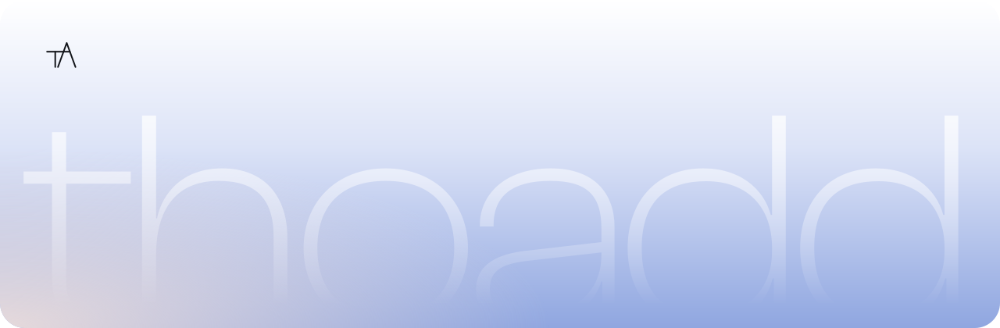
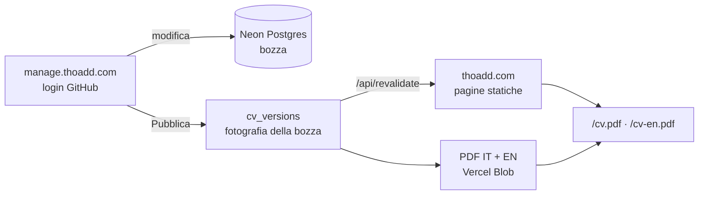

<div align="center">

<a href="https://thoadd.com">
  <picture>
    <source media="(prefers-color-scheme: dark)" srcset=".github/thoadd-dark.svg">
    
  </picture>
</a>

**Il CV online di Thomas Addamo.**<br>
Un sito personale in stile "Atmosfera", un pannello per gestirlo e un CV in PDF sempre aggiornato.

[thoadd.com](https://thoadd.com) · [thoadd.com/cv.pdf](https://thoadd.com/cv.pdf) · [manage.thoadd.com](https://manage.thoadd.com) (privato)

</div>

---

## Indice

- [Come funziona](#come-funziona)
- [Struttura del repository](#struttura-del-repository)
- [Tecnologie](#tecnologie)
- [Avvio in locale](#avvio-in-locale)
- [Variabili d'ambiente](#variabili-dambiente)
- [Database](#database)
- [Pannello e pubblicazione](#pannello-e-pubblicazione)
- [Indirizzi del sito](#indirizzi-del-sito)
- [Design: Atmosfera](#design-atmosfera)
- [Deploy e dominio](#deploy-e-dominio)
- [Sicurezza e privacy](#sicurezza-e-privacy)
- [Diritti](#diritti)

## Come funziona

Tutto il contenuto del CV sta in un database. Dal pannello si modifica una **bozza**; il sito pubblico mostra solo l'ultima **versione pubblicata**, così niente va online per sbaglio.



1. Nel pannello modifichi profilo e sezioni: le modifiche restano in bozza e si vedono nell'anteprima.
2. **Pubblica** salva una versione in `cv_versions`, genera i due PDF e li carica su Vercel Blob.
3. Il pannello chiama `thoadd.com/api/revalidate`, che rigenera subito tutte le pagine in italiano e in inglese.
4. Lo storico delle versioni permette di rimettere online una versione precedente.

## Struttura del repository

Monorepo **pnpm + Turborepo** con due app Next.js e tre pacchetti condivisi.

```
thoadd/
├── apps/
│   ├── web/          thoadd.com: home, pagine progetto, copyright, privacy, /cv.pdf
│   └── manage/       manage.thoadd.com: login, editor, anteprima, Pubblica
├── packages/
│   ├── ui/           token di Atmosfera, font, monogramma TA, tema chiaro/scuro
│   ├── db/           schema Drizzle, migrazioni, client Neon, seed dei segnaposto
│   └── cv-pdf/       il CV in PDF (A4, due pagine) con react-pdf
├── design/atmosfera/ tavole di riferimento esportate da Claude Design
└── scripts/          script di supporto (chiavi OAuth su Vercel)
```

| Cartella | Contiene |
| --- | --- |
| `apps/web/components` | Sezioni della home, navbar, apertura, interazioni, pagine progetto e legali |
| `apps/web/lib` | Testi IT/EN (`i18n.ts`), testi legali, markdown dei progetti |
| `apps/manage/lib` | Configurazione dei moduli (`sections.ts`), sessione, caricamento file |
| `packages/db/src` | `schema.ts`, `content.ts` (bozza e versione pubblicata), `seed.ts` |

## Tecnologie

| Ambito | Scelta |
| --- | --- |
| Framework | Next.js 16 (App Router) · React 19 · TypeScript |
| Stile | Tailwind CSS v4 con i token di Atmosfera come variabili CSS |
| Dati | Neon Postgres (Francoforte) · Drizzle ORM |
| File | Vercel Blob (PDF, immagini, allegati) · sharp per ridimensionare e convertire in WebP |
| PDF | @react-pdf/renderer · qrcode |
| Accesso | GitHub OAuth fatto a mano, sessione firmata con `jose` |
| Hosting | Vercel (funzioni a `fra1`) · DNS su Cloudflare |
| Monorepo | pnpm 10 · Turborepo |

## Avvio in locale

**Requisiti:** Node.js 22 e pnpm 10.

```bash
pnpm install
```

Copia `.env.example` in `.env.local` dentro `apps/web`, `apps/manage` e `packages/db` e compila i valori (vedi la tabella sotto). Poi:

```bash
pnpm dev
```

Il sito è su `localhost:3000` e il pannello su `localhost:3001`. Per il login in locale la OAuth App di GitHub deve avere anche `http://localhost:3001/api/auth/callback` tra i redirect.

| Comando | Cosa fa |
| --- | --- |
| `pnpm dev` | Avvia le due app in sviluppo |
| `pnpm build` | Compila tutto (lo stesso controllo che fa Vercel) |
| `pnpm db:generate` | Crea la migrazione dopo una modifica a `packages/db/src/schema.ts` |
| `pnpm db:migrate` | Applica le migrazioni al database |
| `pnpm --filter @thoadd/db seed` | Rimette i contenuti segnaposto del design (**svuota le tabelle del CV**) |

## Variabili d'ambiente

Nessun segreto è nel repository: i valori stanno nei file `.env.local` (ignorati da git) e nelle impostazioni dei due progetti Vercel.

| Variabile | `web` | `manage` | A cosa serve |
| --- | :---: | :---: | --- |
| `DATABASE_URL` | ✓ | ✓ | Connessione a Neon (serve anche in `packages/db`) |
| `REVALIDATE_SECRET` | ✓ | ✓ | Chiave con cui manage chiede a thoadd.com di rigenerarsi |
| `PREVIEW_SECRET` | ✓ | ✓ | Chiave dell'anteprima della bozza (`/anteprima`) |
| `AUTH_SECRET` | | ✓ | Firma della sessione del pannello |
| `ALLOWED_GITHUB_ID` | | ✓ | L'unico account GitHub che può entrare |
| `GITHUB_CLIENT_ID` · `GITHUB_CLIENT_SECRET` | | ✓ | La OAuth App di GitHub |
| `WEB_URL` | | ✓ | Indirizzo del sito (`https://thoadd.com` o `http://localhost:3000`) |
| `BLOB_READ_WRITE_TOKEN` | | ✓ | Scrittura su Vercel Blob (lo imposta Vercel collegando lo spazio file) |

Per caricare le chiavi della OAuth App su Vercel senza scriverle in nessun file: `scripts/github-oauth-env.sh`.

## Database

Ogni testo visibile è salvato in italiano e, se compilato, in inglese (`{ it, en }`); se manca l'inglese il sito usa l'italiano. Le parole tra `*asterischi*` diventano il corsivo serif blu del design.

| Tabella | Contenuto |
| --- | --- |
| `profile` | Nome, ruolo, hero, bio, dati di contatto, foto |
| `experiences` | **Il mio percorso**: attestati, qualifiche, attività, esperienze |
| `projects` | Progetti con pagina propria: descrizione in markdown, galleria, link, allegati |
| `education` | Studi con stato: completato, in corso, in programma |
| `skills` · `languages` · `certifications` · `links` · `faqs` | Le altre sezioni |
| `cv_versions` | Le versioni pubblicate: fotografia dei contenuti e link ai PDF |
| `cv_downloads` | Conteggio anonimo dei download (data, lingua, versione, paese) |

Le versioni pubblicate prima di un cambio di schema vengono completate con valori predefiniti in `packages/db/src/content.ts`, così restano tutte ripristinabili.

## Pannello e pubblicazione

[manage.thoadd.com](https://manage.thoadd.com) è accessibile solo con l'account GitHub indicato in `ALLOWED_GITHUB_ID`.

- **Panoramica:** anteprima della bozza in IT/EN, pulsante Pubblica, download del CV e storico delle versioni con "Ripristina".
- **Profilo e sezioni:** testi IT/EN affiancati, riordino, nascondi/mostra, elimina con conferma.
- **Immagini:** fino a 4 MB, ridimensionate e convertite in WebP senza metadati; la foto del profilo riceve la filigrana "© thoadd".
- **Progetti:** la descrizione lunga accetta `## titoletti`, `- elenchi`, `**grassetto**`, `*corsivo*` e `[link](https://…)`.

I moduli sono generati da `apps/manage/lib/sections.ts`: per aggiungere un campo basta dichiararlo lì e nello schema.

## Indirizzi del sito

| Indirizzo | Cosa fa |
| --- | --- |
| `/` · `/en` | Home in italiano e in inglese |
| `/progetti/<slug>` · `/en/progetti/<slug>` | Pagina di un progetto |
| `/copyright` · `/privacy` (anche `/en/…`) | Pagine legali |
| `/cv.pdf` · `/cv-en.pdf` | Ultimo CV pubblicato, scaricato come `Thomas-Addamo-CV.pdf`; conta il download |
| `/foto` | Foto del profilo, solo dalle pagine di thoadd.com (protezione contro l'uso da altri siti) |
| `/anteprima?token=…` | Bozza non pubblicata, visibile solo dentro manage |
| `/api/revalidate` | Rigenerazione delle pagine, chiamata da manage con `REVALIDATE_SECRET` |

## Design: Atmosfera

Un cielo chiaro che, scorrendo, si addensa in una nebbia pervinca, con il nome "thoadd" gigante e trasparente in fondo. Il riferimento principale è un footer di Serhii Huba per Equal; le tavole sono in `design/atmosfera`.

- **Colori:** `cloud`, `mist`, `haze`, `aura` (pervinca, colore firma), `iris`, `ink`, `slate`, `night`, `dawn`, definiti in `packages/ui/src/tokens.css`.
- **Tema scuro:** "Atmosfera di notte", con gli stessi token ridefiniti su `[data-theme="dark"]`. All'inizio segue il sistema, poi ricorda la scelta.
- **Font:** Clash Display (titoli), General Sans (testo), Instrument Serif corsivo (accenti).
- **Raggi annidati:** raggio interno = raggio esterno − margine (foglio 32 con margine 16 → immagine 16).
- **Movimento:** apertura con il monogramma che si disegna, rivelazioni allo scroll, luce e inclinazione al passaggio del mouse. Con "riduci movimento" attivo nel sistema tutto si ferma.

## Deploy e dominio

Ogni push su `main` pubblica in produzione; ogni altro branch crea un'anteprima.

| Progetto Vercel | Root directory | Dominio |
| --- | --- | --- |
| `thoadd-web` | `apps/web` | `thoadd.com` (con `www` che rimanda qui) |
| `thoadd-manage` | `apps/manage` | `manage.thoadd.com` |

Su Cloudflare i record puntano a Vercel con il proxy **spento** (nuvola grigia, "DNS only"): con il proxy acceso Vercel non riesce a creare i certificati HTTPS.

## Sicurezza e privacy

- Il pannello è protetto da `proxy.ts` e ogni azione ricontrolla la sessione; i motori di ricerca non lo indicizzano.
- Nessun cookie di profilazione: nel browser restano solo il tema scelto e il giorno dell'ultima apertura.
- I download sono contati senza indirizzo IP; i bot non vengono contati.
- La foto del profilo non ha un indirizzo diretto, non si salva con il tasto destro, non viene indicizzata e ha la filigrana impressa. Uno screenshot resta sempre possibile.
- `robots.txt` esclude i crawler che raccolgono dati per l'intelligenza artificiale.

## Diritti

© Thomas Addamo. **Tutti i diritti riservati**, compreso il codice di questo repository, che è pubblico per trasparenza ma non è distribuito con una licenza open source. "thoadd" e il monogramma TA sono segni distintivi di Thomas Addamo. I dettagli sono su [thoadd.com/copyright](https://thoadd.com/copyright).

Clash Display e General Sans sono di [Fontshare](https://www.fontshare.com) (ITF Free Font License); Instrument Serif è su [Google Fonts](https://fonts.google.com/specimen/Instrument+Serif) (SIL Open Font License).
